The Islands, Part 2: Study
================
Arianne, Laurel, Karis
2026-11-09

- [Grading Rubric](#grading-rubric)
  - [Individual](#individual)
  - [Submission](#submission)
- [Setup](#setup)
  - [**q1** Planning a study (TEAMWORK)](#q1-planning-a-study-teamwork)
  - [**q2** EDA](#q2-eda)
  - [**q3** Key Analyses](#q3-key-analyses)
  - [**q4** Answers](#q4-answers)

*Purpose*: This is part 2 of 2. In part 1 you *planed* your statistical
project, particularly your data collection. In this part you will give
updates on your plan, and report your findings.

This challenge is deliberately shorter so you have time to collect and
analyze your data.

*Important note*: While we expect that you did your data collection with
your team, you need to complete your own individual report for c10.

<!-- include-rubric -->

# Grading Rubric

<!-- -------------------------------------------------- -->

Unlike exercises, **challenges will be graded**. The following rubrics
define how you will be graded, both on an individual and team basis.

## Individual

<!-- ------------------------- -->

| Category | Needs Improvement | Satisfactory |
|----|----|----|
| Effort | Some task **q**’s left unattempted | All task **q**’s attempted |
| Observed | Did not document observations, or observations incorrect | Documented correct observations based on analysis |
| Supported | Some observations not clearly supported by analysis | All observations clearly supported by analysis (table, graph, etc.) |
| Assessed | Observations include claims not supported by the data, or reflect a level of certainty not warranted by the data | Observations are appropriately qualified by the quality & relevance of the data and (in)conclusiveness of the support |
| Specified | Uses the phrase “more data are necessary” without clarification | Any statement that “more data are necessary” specifies which *specific* data are needed to answer what *specific* question |
| Code Styled | Violations of the [style guide](https://style.tidyverse.org/) hinder readability | Code sufficiently close to the [style guide](https://style.tidyverse.org/) |

## Submission

<!-- ------------------------- -->

Make sure to commit both the challenge report (`report.md` file) and
supporting files (`report_files/` folder) when you are done! Then submit
a link to Canvas. **Your Challenge submission is not complete without
all files uploaded to GitHub.**

# Setup

<!-- ----------------------------------------------------------------------- -->

``` r
library(tidyverse)
```

    ## Warning: package 'tidyverse' was built under R version 4.5.3

    ## Warning: package 'ggplot2' was built under R version 4.5.3

    ## Warning: package 'tibble' was built under R version 4.5.3

    ## Warning: package 'tidyr' was built under R version 4.5.3

    ## Warning: package 'readr' was built under R version 4.5.3

    ## Warning: package 'purrr' was built under R version 4.5.3

    ## Warning: package 'dplyr' was built under R version 4.5.3

    ## Warning: package 'stringr' was built under R version 4.5.3

    ## Warning: package 'forcats' was built under R version 4.5.3

    ## Warning: package 'lubridate' was built under R version 4.5.3

    ## ── Attaching core tidyverse packages ──────────────────────── tidyverse 2.0.0 ──
    ## ✔ dplyr     1.2.1     ✔ readr     2.2.0
    ## ✔ forcats   1.0.1     ✔ stringr   1.6.0
    ## ✔ ggplot2   4.0.3     ✔ tibble    3.3.1
    ## ✔ lubridate 1.9.5     ✔ tidyr     1.3.2
    ## ✔ purrr     1.2.2     
    ## ── Conflicts ────────────────────────────────────────── tidyverse_conflicts() ──
    ## ✖ dplyr::filter() masks stats::filter()
    ## ✖ dplyr::lag()    masks stats::lag()
    ## ℹ Use the conflicted package (<http://conflicted.r-lib.org/>) to force all conflicts to become errors

``` r
library(rsample)
```

    ## Warning: package 'rsample' was built under R version 4.5.3

``` r
library(broom)
```

    ## Warning: package 'broom' was built under R version 4.5.3

``` r
# TODO: Include any other packages you need
```

### **q1** Planning a study (TEAMWORK)

While you provided this plan in c08 (Part 1), please include your plan
here. In particular, describe how you updated your plan in response to
feedback.

#### Population

- (What population are you going to study?)
  - All of the Islanders? Only the residents of Helvig? Participants
    meeting certain criteria (in which case, you need to list
    *covariates*)?

#### Quantity of interest

- (Write your quantity of interest here)

#### Covariates

- (Write any relevant covariates here)
- (There’s probably more than one!)

#### Observation or experiment?

The Islands allows you to ask islanders to complete tasks. If you just
take measurements on your participants, then it’s an *observational
study*. But if you also introduce something that’s meant to change the
outcome of a measurement (e.g., drinking coffee before taking a test),
that’s called an *experimental study*. You need to decide whether your
study is observational or experimental.

- (Observation or experiment?)

#### Question / Hypothesis

- (Write your question / hypothesis here)
  - This could be an observational question, like “How are X and Y
    related in the population?”
  - This could be an experimental question, like “What effect does X
    have on Y in the population?”

#### Sampling plan

- (What steps will you take to collect the data?)
  - Be specific. For instance, if you’re going to collect a random
    sample, how will you enumerate all of the things to be sampled?
  - Write a protocol. Document step-by-step instructions that your team
    will follow. That way, you can feasibly split up data collection
    among the whole team, while making sure each team member doesn’t
    make ad hoc decisions that introduce bias into your results.
- (How will you ensure the data is representative of your chosen
  population?)
- (For experiments only: How will you ensure any effects you observe are
  due to the treatment, and not due to other factors?)
- (How will you choose your sample size?)
  - This should be a mix of how confident you want to be in your
    results, and what is actually *feasible* for your research team.

#### Data collection

``` r
## Select a random sample of houses
n_houses <- 657 # Total number of houses
n_sample <- 150  # Desired sample size

set.seed(101)   # Set a seed for reproducibility

df_numbers_random <- 
  tibble(
    house = sample(
        1:n_houses,     # All integers from 1 to n_houses
        n_sample,       # Size of our sample
        replace = FALSE # Sample *WITHOUT* replacement
      )
  ) %>% 
  # Arrange for our data collection convenience
  arrange(house)

# Pull the column so we can list just the house numbers
df_numbers_random %>% 
  pull(house)
```

    ##   [1]   2   3   5   7   9  14  15  17  22  28  37  38  53  57  58  64  72  78
    ##  [19]  80  82  88  93  94  95  97 104 109 114 117 129 131 137 141 145 147 159
    ##  [37] 167 171 178 192 197 201 202 203 204 206 208 209 211 217 220 227 240 244
    ##  [55] 245 246 249 253 258 260 261 263 266 268 270 276 298 299 301 304 310 312
    ##  [73] 313 315 316 317 323 351 352 355 374 377 379 381 391 393 396 398 402 403
    ##  [91] 406 408 410 415 421 430 442 444 449 452 454 468 474 483 485 489 490 491
    ## [109] 500 503 504 505 509 517 518 519 520 521 522 527 534 538 539 542 546 549
    ## [127] 555 556 557 564 571 573 577 582 583 593 594 597 598 610 612 629 639 640
    ## [145] 644 646 648 650 655 656

``` r
filename_adult_count = "./data/adult_counts.csv"
df_adult_counts <- read_csv(filename_adult_count)
```

    ## Rows: 150 Columns: 2
    ## ── Column specification ────────────────────────────────────────────────────────
    ## Delimiter: ","
    ## dbl (2): house_number, number_of_adults
    ## 
    ## ℹ Use `spec()` to retrieve the full column specification for this data.
    ## ℹ Specify the column types or set `show_col_types = FALSE` to quiet this message.

``` r
set.seed(101)   # Set a seed for reproducibility

seeds <- sample(101, n_sample, replace = TRUE)

df_adult_counts %>% 
  mutate(
    seed = seeds,
  ) %>% 
  rowwise() %>% 
  mutate(
    adult_of_interest = {
      set.seed(seed)
      sample(1:number_of_adults, 1)
    }
  ) %>% 
  ungroup() %>% 
  # Arrange for our data collection convenience
  arrange(house_number) %>% 
  write.csv("./data/adult_of_interest.csv", row.names = FALSE)
```

### **q2** EDA

Conduct an EDA on your data. Add as many code chunks as you need. Ensure
your EDA gives enough context of the data for us to understand what
comes next in this report.

``` r
# Import data

filename_sample <- "./data/maeva_sample.csv"

df_maeva <- 
  read_csv(
    filename_sample,
    col_names = c(
    "house",
    "number_of_adults",
    "adult_of_interest",
    "name",
    "age",
    "total_friends",
    "friends_lost",
    "kids"
    ),
    skip = 1
  ) %>% 
  mutate(current_friends = total_friends - friends_lost) %>%
  mutate(ratio_friends = current_friends / total_friends) %>%
  filter(number_of_adults > 0) %>%
  dplyr::select(house, name, age, total_friends, friends_lost, current_friends, ratio_friends, kids)
```

    ## Rows: 150 Columns: 8
    ## ── Column specification ────────────────────────────────────────────────────────
    ## Delimiter: ","
    ## chr (1): name
    ## dbl (7): house, number_of_adults, adult_of_interest, age, total_friends, fri...
    ## 
    ## ℹ Use `spec()` to retrieve the full column specification for this data.
    ## ℹ Specify the column types or set `show_col_types = FALSE` to quiet this message.

``` r
df_maeva
```

    ## # A tibble: 148 × 8
    ##    house name       age total_friends friends_lost current_friends ratio_friends
    ##    <dbl> <chr>    <dbl>         <dbl>        <dbl>           <dbl>         <dbl>
    ##  1     2 Connor …    88            39           14              25         0.641
    ##  2     3 Elle Co…    21            25            7              18         0.72 
    ##  3     5 Arabell…    23            21            5              16         0.762
    ##  4     7 Jonas B…    46            37            9              28         0.757
    ##  5     9 Jules D…    19            18            6              12         0.667
    ##  6    14 Rachida…    72            33           15              18         0.545
    ##  7    15 Dheer K…    67            42           17              25         0.595
    ##  8    17 Yash Ch…    75            20            7              13         0.65 
    ##  9    22 Leon Su…    44            12            7               5         0.417
    ## 10    28 Sven So…    62            22            7              15         0.682
    ## # ℹ 138 more rows
    ## # ℹ 1 more variable: kids <dbl>

``` r
# Basic EDA on number of friends and number of kids

df_maeva %>% 
  ggplot(aes(age, kids)) +
  geom_count()
```

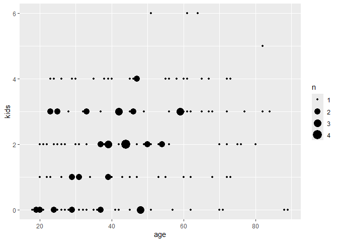<!-- -->

``` r
df_maeva %>% 
  ggplot(aes(kids, current_friends)) +
  geom_count()
```

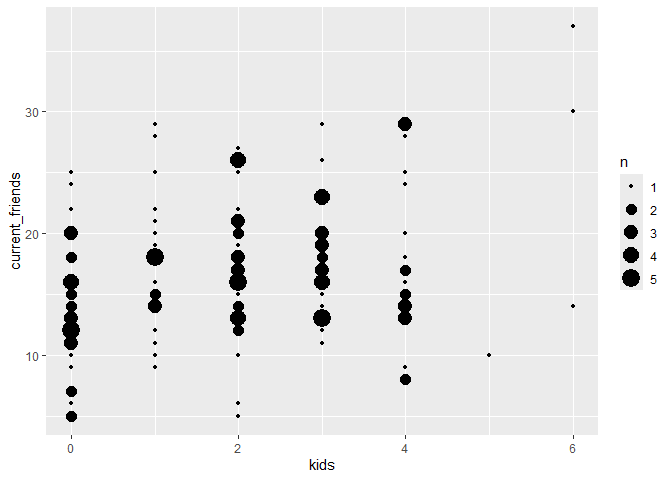<!-- -->

``` r
df_maeva %>% 
  ggplot(aes(age, total_friends)) +
  geom_point()
```

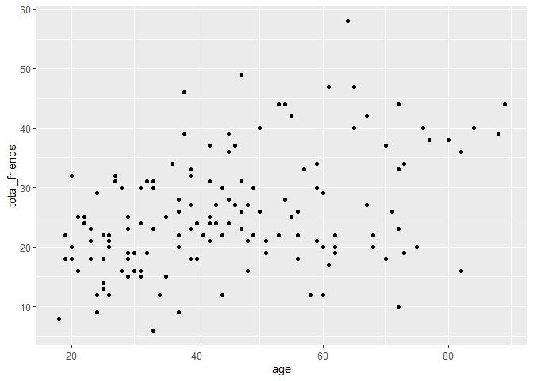<!-- -->

``` r
df_maeva %>% 
  ggplot(aes(kids, friends_lost)) +
  geom_count()
```

<!-- -->

``` r
df_maeva %>%
  ggplot(aes(x = as.factor(kids), y = total_friends)) +
  geom_boxplot() +
  labs(
    title = "Relationship between number of kids and total friends",
    x = "Number of kids",
    y = "Total number of Friends"
  )
```

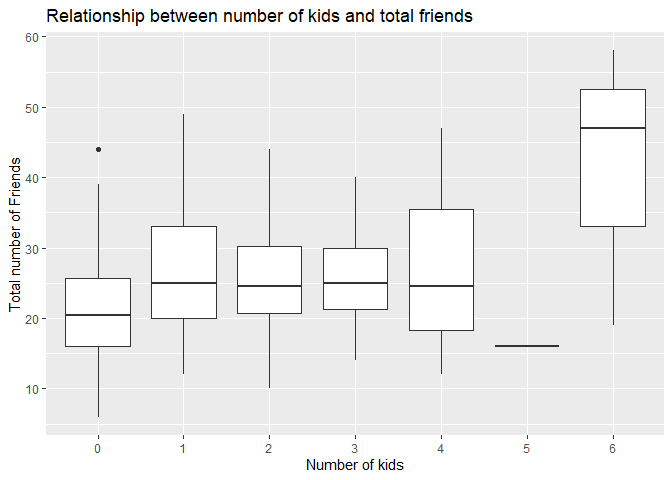<!-- -->

``` r
df_maeva %>%
  ggplot(aes(kids)) +
  geom_bar() +
  labs(
    title = "Number of Adults Sampled With Same Number of Kids",
    x = "Number of Kids",
    y = "Number of Adults"
  )
```

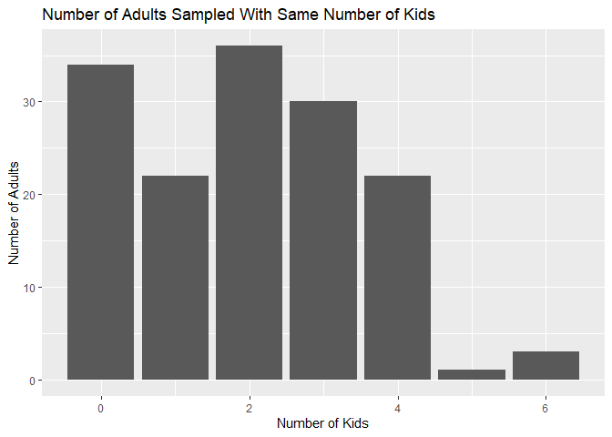<!-- -->

``` r
df_maeva %>% 
  ggplot(aes(age, total_friends, color = factor(kids))) +
  geom_point(alpha = 0.5) +
  geom_smooth(se = FALSE) +
  labs(
    title = "Age vs. Total Friends Per Number of Kids Trends"
  )
```

    ## `geom_smooth()` using method = 'loess' and formula = 'y ~ x'

    ## Warning in simpleLoess(y, x, w, span, degree = degree, parametric = parametric,
    ## : span too small.  fewer data values than degrees of freedom.

    ## Warning in simpleLoess(y, x, w, span, degree = degree, parametric = parametric,
    ## : pseudoinverse used at 50.935

    ## Warning in simpleLoess(y, x, w, span, degree = degree, parametric = parametric,
    ## : neighborhood radius 10.065

    ## Warning in simpleLoess(y, x, w, span, degree = degree, parametric = parametric,
    ## : reciprocal condition number 0

    ## Warning in simpleLoess(y, x, w, span, degree = degree, parametric = parametric,
    ## : There are other near singularities as well. 9.3942

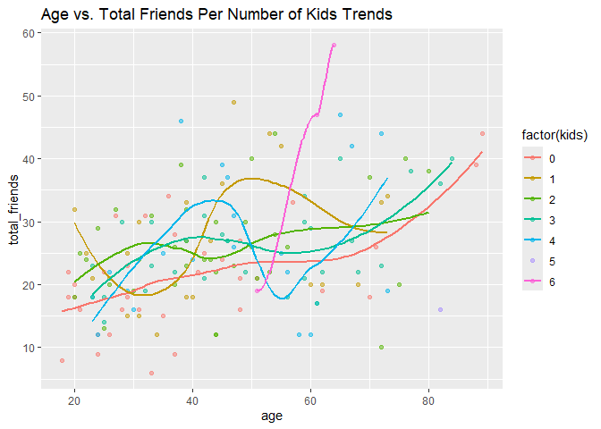<!-- -->

``` r
df_maeva %>%
  ggplot(aes(age, total_friends, color = factor(kids))) +
  geom_line() +
  labs(
    title = "Age vs. Total Friends Per Number of Kids"
  )
```

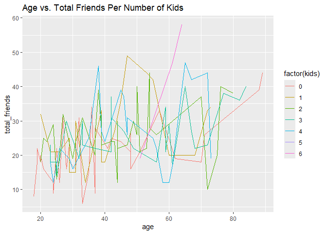<!-- -->

``` r
df_maeva %>% 
  ggplot(aes(age, kids)) +
  geom_boxplot(aes(group = kids)) +
  geom_count()
```

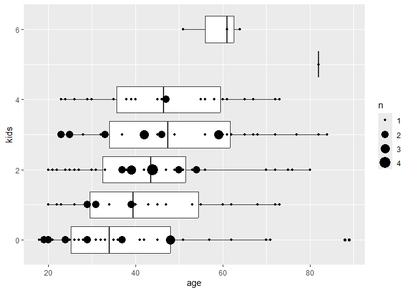<!-- -->

``` r
df_maeva %>% 
  ggplot(aes(kids, total_friends)) +
  geom_boxplot(aes(group = kids)) +
  geom_count()
```

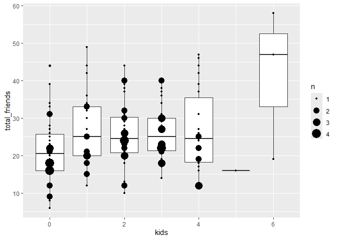<!-- -->

``` r
df_maeva %>% 
  ggplot(aes(age, ratio_friends)) +
  geom_point() + 
  geom_smooth(method = "lm")
```

    ## `geom_smooth()` using formula = 'y ~ x'

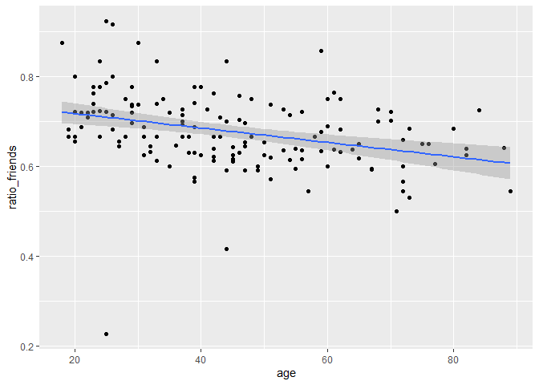<!-- -->

``` r
df_maeva %>% 
  ggplot(aes(kids, ratio_friends)) +
  geom_point()
```

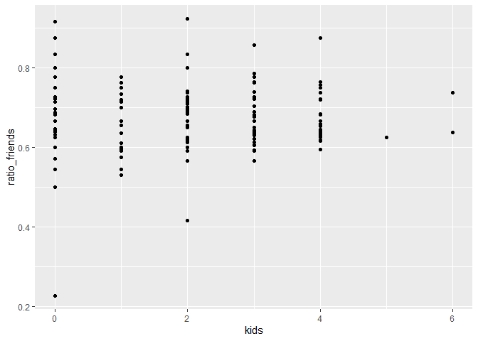<!-- -->

``` r
df_maeva %>% 
  ggplot(aes(kids, friends_lost)) +
  geom_count()
```

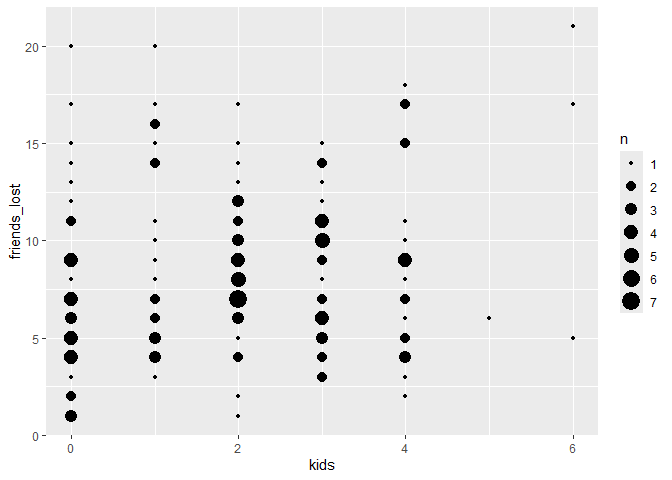<!-- -->

``` r
df_maeva %>% 
  ggplot(aes(ratio_friends)) +
  geom_histogram(bins = 15)
```

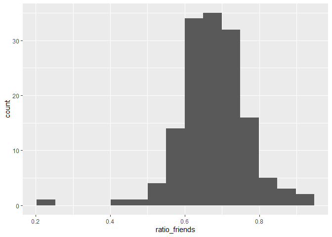<!-- -->

``` r
df_maeva %>% 
  lm(
    formula = current_friends ~ kids,
    data = .
  ) %>% 
  summary()
```

    ## 
    ## Call:
    ## lm(formula = current_friends ~ kids, data = .)
    ## 
    ## Residuals:
    ##      Min       1Q   Median       3Q      Max 
    ## -11.8315  -3.8315  -0.8315   3.2996  15.9062 
    ## 
    ## Coefficients:
    ##             Estimate Std. Error t value Pr(>|t|)    
    ## (Intercept)  14.7004     0.7704   19.08  < 2e-16 ***
    ## kids          1.0656     0.3088    3.45 0.000733 ***
    ## ---
    ## Signif. codes:  0 '***' 0.001 '**' 0.01 '*' 0.05 '.' 0.1 ' ' 1
    ## 
    ## Residual standard error: 5.636 on 146 degrees of freedom
    ## Multiple R-squared:  0.07538,    Adjusted R-squared:  0.06905 
    ## F-statistic:  11.9 on 1 and 146 DF,  p-value: 0.0007328

``` r
df_maeva %>%
  mutate(
    kids = as_factor(kids) %>% 
      fct_relevel(., "1")
  ) %>% 
  lm(
    formula = current_friends ~ kids + age,
    data = .
  ) %>%
  summary()
```

    ## 
    ## Call:
    ## lm(formula = current_friends ~ kids + age, data = .)
    ## 
    ## Residuals:
    ##      Min       1Q   Median       3Q      Max 
    ## -14.1873  -3.4712  -0.2882   3.2279  12.2831 
    ## 
    ## Coefficients:
    ##              Estimate Std. Error t value Pr(>|t|)    
    ## (Intercept)  13.12863    1.57554   8.333 6.57e-14 ***
    ## kids0        -3.26135    1.44194  -2.262 0.025252 *  
    ## kids2        -0.22318    1.42343  -0.157 0.875638    
    ## kids3        -0.45890    1.48806  -0.308 0.758245    
    ## kids4        -0.25491    1.58945  -0.160 0.872816    
    ## kids5       -11.42189    5.47176  -2.087 0.038662 *  
    ## kids6         7.93798    3.26246   2.433 0.016230 *  
    ## age           0.10114    0.02588   3.908 0.000144 ***
    ## ---
    ## Signif. codes:  0 '***' 0.001 '**' 0.01 '*' 0.05 '.' 0.1 ' ' 1
    ## 
    ## Residual standard error: 5.259 on 140 degrees of freedom
    ## Multiple R-squared:  0.2281, Adjusted R-squared:  0.1895 
    ## F-statistic:  5.91 on 7 and 140 DF,  p-value: 4.947e-06

No reference group

``` r
df_maeva %>% 
  lm(
    formula = current_friends ~ as_factor(kids) + 0,
    data = .
  ) %>% 
  summary() %>% 
  tidy()
```

    ## # A tibble: 7 × 5
    ##   term             estimate std.error statistic  p.value
    ##   <chr>               <dbl>     <dbl>     <dbl>    <dbl>
    ## 1 as_factor(kids)0     13.8     0.946     14.6  5.24e-30
    ## 2 as_factor(kids)1     17.5     1.18      14.8  1.38e-30
    ## 3 as_factor(kids)2     17.4     0.920     18.9  2.02e-40
    ## 4 as_factor(kids)3     17.7     1.01      17.6  2.09e-37
    ## 5 as_factor(kids)4     17.6     1.18      15.0  5.61e-31
    ## 6 as_factor(kids)5     10       5.52       1.81 7.21e- 2
    ## 7 as_factor(kids)6     27       3.19       8.47 2.83e-14

### **q3** Key Analyses

Present the key analyses that support your questions / hypotheses. This
could include summary statistics (e.g., a proportion of Islanders),
grouped summary statistics (e.g., a proportion for group A, and for
group B), or visualizations (e.g., a histogram). This section should be
short, and every analysis should directly relate to q4.

``` r
df_maeva %>%
  mutate(
    kids = as_factor(kids) %>% 
      fct_relevel(., "1")
  ) %>% 
  lm(
    formula = current_friends ~ kids,
    data = .
  ) %>%
  summary()
```

    ## 
    ## Call:
    ## lm(formula = current_friends ~ kids, data = .)
    ## 
    ## Residuals:
    ##      Min       1Q   Median       3Q      Max 
    ## -13.0000  -3.6364  -0.6848   2.7292  11.5455 
    ## 
    ## Coefficients:
    ##             Estimate Std. Error t value Pr(>|t|)    
    ## (Intercept) 17.45455    1.17650  14.836  < 2e-16 ***
    ## kids0       -3.63102    1.50990  -2.405  0.01748 *  
    ## kids2       -0.09343    1.49333  -0.063  0.95020    
    ## kids3        0.27879    1.54894   0.180  0.85742    
    ## kids4        0.18182    1.66383   0.109  0.91314    
    ## kids5       -7.45455    5.64231  -1.321  0.18858    
    ## kids6        9.54545    3.39627   2.811  0.00565 ** 
    ## ---
    ## Signif. codes:  0 '***' 0.001 '**' 0.01 '*' 0.05 '.' 0.1 ' ' 1
    ## 
    ## Residual standard error: 5.518 on 141 degrees of freedom
    ## Multiple R-squared:  0.1439, Adjusted R-squared:  0.1075 
    ## F-statistic:  3.95 on 6 and 141 DF,  p-value: 0.001107

Making a linear model using our data with number of kids and age as
variables, we saw that people with 1, 2, 3, or 4 kids are all similar -
the p-values of the correlations are very high, suggesting that there’s
no meaningful difference.

``` r
df_maeva %>%
  ggplot(aes(kids)) +
  geom_bar() +
  labs(
    title = "Number of Adults Sampled With Same Number of Kids",
    x = "Number of Kids",
    y = "Number of Adults"
  )
```

<!-- -->

We are also unable to make conclusions about adults with 5 or 6 kids
because our sample size is too small, with only one adult with 5 kids
and three adults with 6 kids in our sample.

``` r
df_maeva %>% 
  ggplot(aes(age, kids)) +
  geom_boxplot(aes(group = kids)) +
  geom_count()
```

<!-- -->

Younger adults tend to have fewer kids, so we also controlled for age by
adding it as a variable to the linear model.

``` r
df_maeva %>%
  mutate(
    kids = as_factor(kids) %>% 
      fct_relevel(., "1")
  ) %>% 
  lm(
    formula = current_friends ~ kids + age,
    data = .
  ) %>%
  summary()
```

    ## 
    ## Call:
    ## lm(formula = current_friends ~ kids + age, data = .)
    ## 
    ## Residuals:
    ##      Min       1Q   Median       3Q      Max 
    ## -14.1873  -3.4712  -0.2882   3.2279  12.2831 
    ## 
    ## Coefficients:
    ##              Estimate Std. Error t value Pr(>|t|)    
    ## (Intercept)  13.12863    1.57554   8.333 6.57e-14 ***
    ## kids0        -3.26135    1.44194  -2.262 0.025252 *  
    ## kids2        -0.22318    1.42343  -0.157 0.875638    
    ## kids3        -0.45890    1.48806  -0.308 0.758245    
    ## kids4        -0.25491    1.58945  -0.160 0.872816    
    ## kids5       -11.42189    5.47176  -2.087 0.038662 *  
    ## kids6         7.93798    3.26246   2.433 0.016230 *  
    ## age           0.10114    0.02588   3.908 0.000144 ***
    ## ---
    ## Signif. codes:  0 '***' 0.001 '**' 0.01 '*' 0.05 '.' 0.1 ' ' 1
    ## 
    ## Residual standard error: 5.259 on 140 degrees of freedom
    ## Multiple R-squared:  0.2281, Adjusted R-squared:  0.1895 
    ## F-statistic:  5.91 on 7 and 140 DF,  p-value: 4.947e-06

Even after controlling for age, there is still a high correlation
between having no kids and having fewer friends.

### **q4** Answers

Connect your Key Analyses to your questions / hypotheses. What did you
conclude from your study?

Having no kids has a high correlation with having fewer friends, even
after controlling for age.
